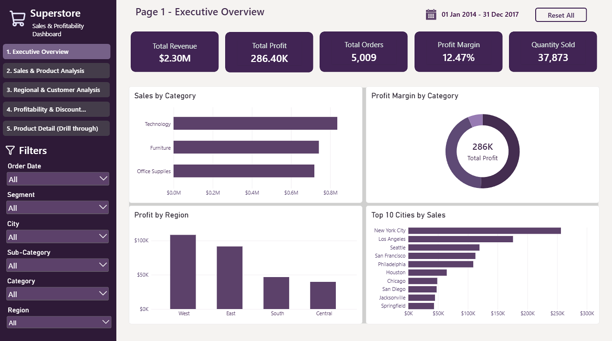
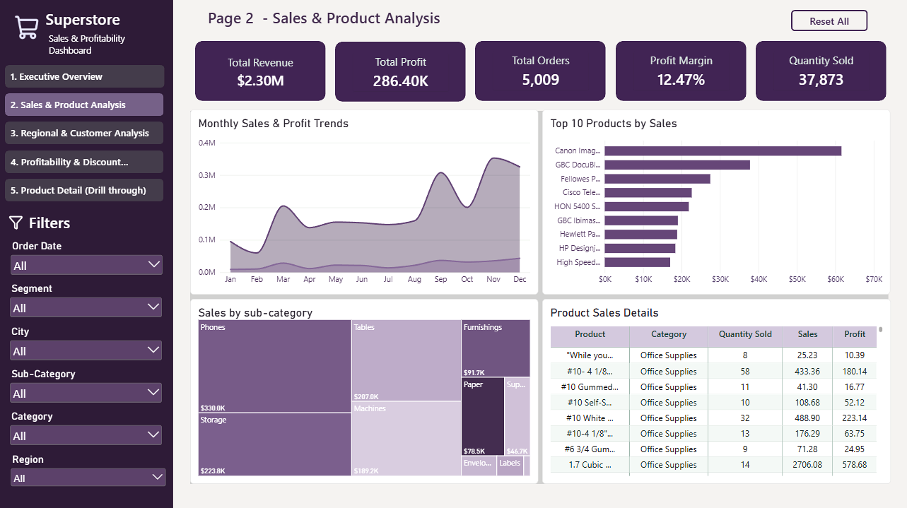
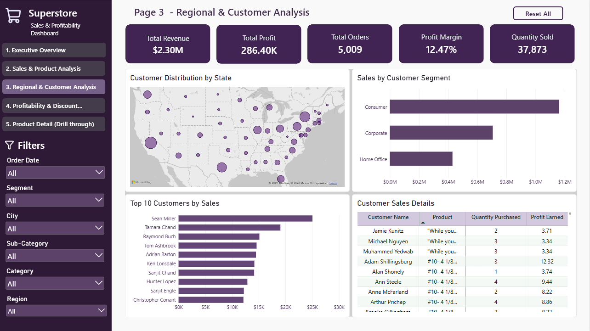
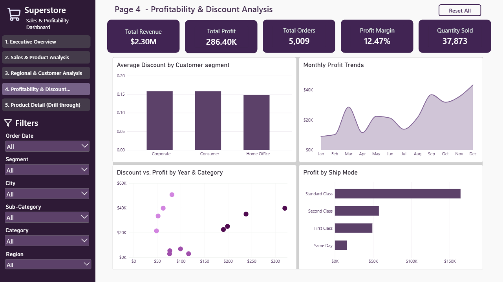
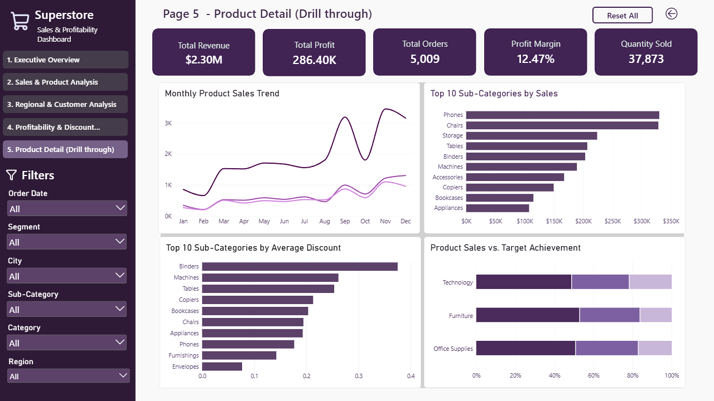

# Superstore Sales & Profitability Dashboard

An interactive Power BI dashboard built using the Sample Superstore dataset to analyze sales, profitability, customer behavior, regional trends, and product performance.

## Dashboard Preview

### 1. Executive Overview

### 2. Sales & Product Analysis

### 3. Regional & Customer Analysis

### 4. Profitability & Discount Analysis

### 5. Product Detail

## Dashboard Pages

| Page | Description |
|---|---|
| Executive Overview | Key performance indicators and overall business performance |
| Sales & Product Analysis | Sales trends and product performance |
| Regional & Customer Analysis | Geographic distribution and customer segment analysis |
| Profitability & Discount Analysis | Profitability patterns and discount analysis |
| Product Detail | Product-level insights with drill-through navigation |

## Key Features

- Interactive KPI cards, charts, and slicers
- Sales and profit trend analysis
- Regional and customer segment comparisons
- Discount and profitability analysis
- Product-level drill-through navigation
- Interactive filters for exploring business performance
- Consistent visual design across report pages

## Tools & Technologies

- Microsoft Power BI Desktop
- DAX
- Power Query
- CSV dataset

## Dataset & Attribution

This project uses the **Sample Supermarket Dataset** sourced from Kaggle.

- **Dataset source:** [Sample Supermarket Dataset — Kaggle](https://www.kaggle.com/datasets/bravehart101/sample-supermarket-dataset)
- **Data file:** `SampleSuperstore.csv`
- **License:** CC0: Public Domain, as indicated on the dataset page
- **Purpose:** Sales, profitability, customer, regional, and product performance analysis

The dashboard design, data modeling, visualizations, and analysis were developed as part of this project.

## Getting Started

1. Clone or download this repository.
2. Open `Sample-Superstore-Dashboard.pbix` in Power BI Desktop.
3. If prompted, update the data source path to the location of the CSV file.
4. Refresh the dataset if required.
5. Explore the dashboard using the filters, slicers, and drill-through features.

## Project Objective

This project demonstrates practical skills in data analysis, data visualization, dashboard design, and interactive reporting using Microsoft Power BI.

---

**Created by:** Gurleen Kaur
